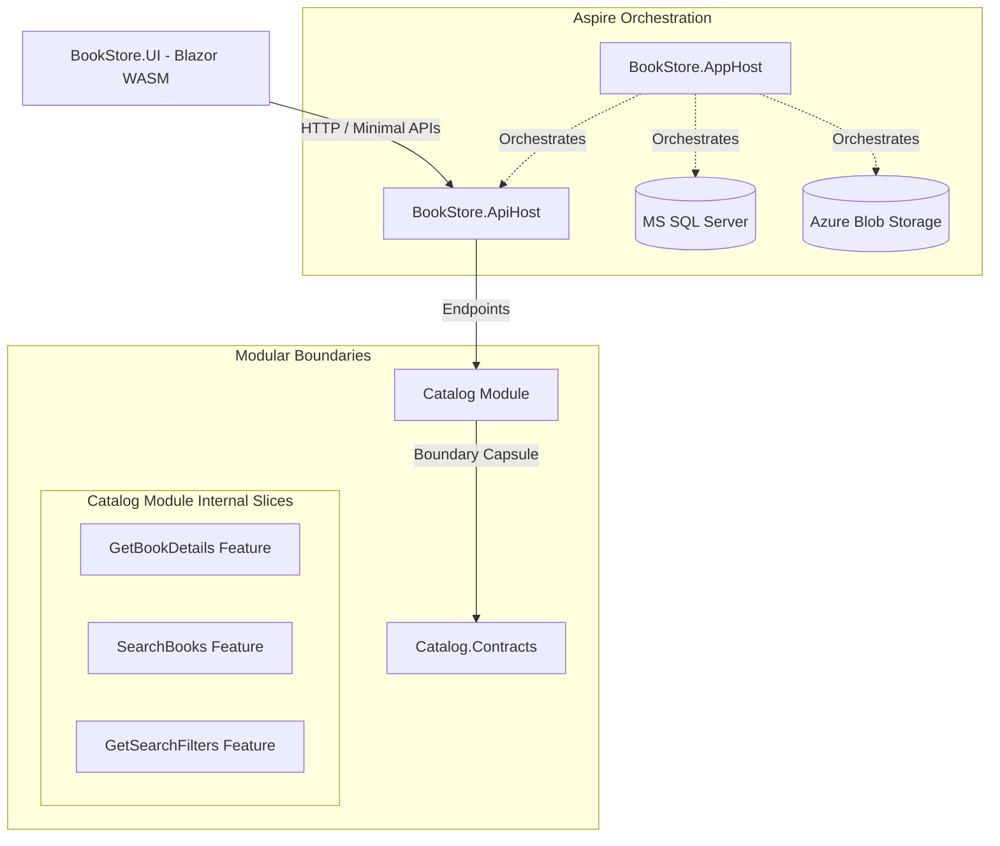

# 📚 BookStore

[](https://dotnet.microsoft.com/)
[](https://learn.microsoft.com/en-us/dotnet/csharp/)
[](https://learn.microsoft.com/en-us/dotnet/aspire/)
[](#-architecture)
[](LICENSE)

BookStore is a .NET 10 application built to showcase modern development practices, utilizing a Modular Monolith with Vertical Slice Architecture, Minimal APIs, and .NET Aspire for cloud-native orchestration. It is designed with a strong focus on boundary isolation, testability, and clean code to deliver a clean, robust, and well-tested codebase. This project is continuously evolving, with new modules and features being actively built.

## 🌟 Tech Stack

- **Backend:** .NET 10, ASP.NET Core Minimal APIs, Entity Framework Core 10
- **Frontend:** Blazor WebAssembly
- **Orchestration:** .NET Aspire, OpenTelemetry, Azure Blob Storage (Azurite)
- **Database:** MS SQL Server
- **Testing:** xUnit v3, FluentAssertions, NSubstitute, Testcontainers

## 🏗️ Architecture

The system uses a **Modular Monolith** approach, with **Vertical Slice Architecture** applied internally within modules.



### Key Principles

- **Isolated Boundaries:** Modules communicate strictly through `Contracts`. Implementation details remain `internal` within module assemblies to prevent tight coupling.
- **Vertical Slices:** Features (e.g., endpoints, handlers, validators) are grouped together by capability rather than horizontal layers.
- **Quality Assurance:** Covered by isolated unit tests and full integration tests using containerized databases to verify real-world behavior.

## 📂 Project Structure

```text
├── .aspire/                 # Aspire orchestration assets
├── src/
│   ├── Hosts/               # API, Blazor UI, Aspire AppHost
│   ├── Modules/             # Core modules (e.g., Catalog)
│   └── Shared/              # Shared configurations and utilities
└── tests/                   # Unit and integration tests
```

## 🚀 Getting Started

To run the multi-service application locally:

1. Install the [.NET 10 SDK](https://dotnet.microsoft.com/download/dotnet/10.0) required by `global.json` and [Docker Desktop](https://www.docker.com/products/docker-desktop/), and start Docker.
2. Install Aspire CLI **13.6.4**:
   ```bash
   dotnet tool install --global Aspire.Cli --version 13.6.4
   ```
   If Aspire CLI is already installed as a global .NET tool, update it instead:
   ```bash
   dotnet tool update --global Aspire.Cli --version 13.6.4
   ```
   Ensure the .NET global tools directory is on your `PATH`.
3. Clone the repository and run the AppHost from the repository root:
   ```bash
   aspire run --apphost src/Hosts/BookStore.AppHost --non-interactive
   ```
4. Open the Aspire Dashboard URL provided in the console. If prompted to trust development certificates, run `aspire certs trust`.

## 🤝 Let's Connect

Feel free to reach out to discuss modern .NET architecture, software engineering, or potential opportunities.

- 💼 **LinkedIn:** [Peter Kovecses](https://www.linkedin.com/in/peterkovecses/)
- ⭐ **Give it a Star:** If you like what you see, please star this repository—it helps!
