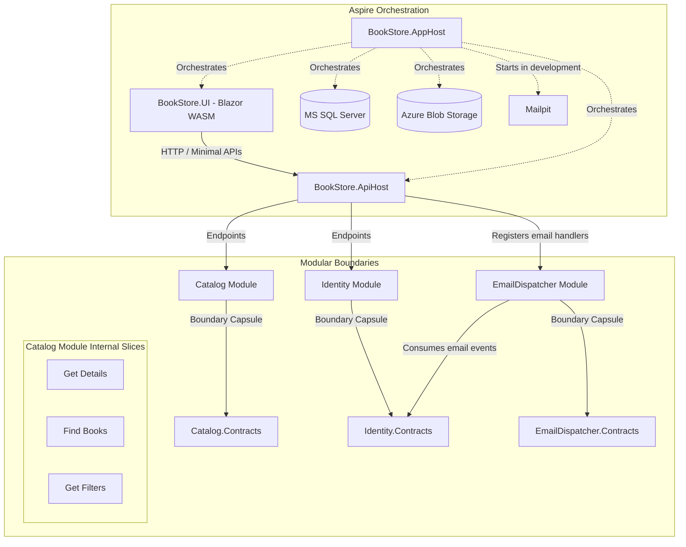

# 📚 BookStore

[](https://dotnet.microsoft.com/)
[](https://learn.microsoft.com/en-us/dotnet/csharp/)
[](https://learn.microsoft.com/en-us/dotnet/aspire/)
[](#-architecture)
[](LICENSE)

BookStore is a .NET 10 application built to showcase modern development practices, utilizing a Modular Monolith with Vertical Slice Architecture, Minimal APIs, and .NET Aspire for cloud-native orchestration. It is designed with a strong focus on boundary isolation, testability, and clean code to deliver a clean, robust, and well-tested codebase. This project is continuously evolving, with new modules and features being actively built.

## 🌟 Tech Stack

- **Backend:** .NET 10, ASP.NET Core Minimal APIs, Entity Framework Core 10
- **Frontend:** Blazor WebAssembly
- **Orchestration:** .NET Aspire, OpenTelemetry, Azure Blob Storage (Azurite)
- **Database:** MS SQL Server
- **Testing:** xUnit v3, FluentAssertions, NSubstitute, Testcontainers

## 🏗️ Architecture

The system uses a **Modular Monolith** approach, with **Vertical Slice Architecture** applied internally within modules.



### Key Principles

- **Isolated Boundaries:** Modules communicate strictly through `Contracts`. Implementation details remain `internal` within module assemblies to prevent tight coupling.
- **Vertical Slices:** Features (e.g., endpoints, handlers, validators) are grouped together by capability rather than horizontal layers.
- **Quality Assurance:** Covered by isolated unit tests and full integration tests using containerized databases to verify real-world behavior.

## 📂 Project Structure

```text
├── .aspire/                 # Aspire orchestration assets
├── src/
│   ├── Hosts/               # API, Blazor UI, Aspire AppHost
│   ├── Modules/             # Core modules (e.g., Catalog)
│   └── Shared/              # Shared configurations and utilities
└── tests/                   # Unit and integration tests
```

## 🚀 Getting Started

Follow these steps from the repository root. Steps 2–3 are only for a fresh API setup. If a key ring already exists, restore its matching certificate and settings instead of generating new credentials. The User Secrets import replaces matching values, so skip it when those settings already exist.

### 1. Install the tools

Install the [.NET 10 SDK](https://dotnet.microsoft.com/download/dotnet/10.0), [Docker Desktop](https://www.docker.com/products/docker-desktop/), and Aspire CLI **13.6.5** (the tested version matching this AppHost's SDK):
```bash
dotnet tool install --global Aspire.Cli --version 13.6.5
```

The setup commands use Bash, OpenSSL, Python 3, and the .NET CLI. On Windows, use WSL; native PowerShell is not supported by these commands.

### 2. Create the Data Protection certificate

This creates a password-protected RSA certificate outside the repository. The PFX contains its private key; the API uses the certificate to encrypt Data Protection keys and needs the private key to read them. The PEM files are temporary and removed after export. OpenSSL prompts to set and confirm the private-key password, asks for it again to export the PFX, then prompts for the PFX password; the certificate subject is set automatically.

```bash
set -euo pipefail
umask 077
CERT_DIR="$HOME/.local/share/bookstore/data-protection"
mkdir -p "$CERT_DIR"
chmod 700 "$CERT_DIR"
KEY_RING="src/Hosts/BookStore.Api/.data-protection-keys"
if [ -n "$(find "$KEY_RING" -maxdepth 1 -name 'key-*.xml' -print -quit 2>/dev/null)" ]; then
  echo "An existing key ring was found; restore its matching certificate instead of creating a new one." >&2
  exit 1
fi
for file in "$CERT_DIR/development-key.pem" "$CERT_DIR/development-cert.pem" "$CERT_DIR/development.pfx"; do
  if [ -e "$file" ]; then
    echo "An existing certificate file was found; refusing to overwrite it." >&2
    exit 1
  fi
done
openssl req -x509 -newkey rsa:3072 \
  -subj "/CN=BookStore Development Data Protection" \
  -keyout "$CERT_DIR/development-key.pem" \
  -out "$CERT_DIR/development-cert.pem" -days 365
openssl pkcs12 -export \
  -inkey "$CERT_DIR/development-key.pem" \
  -in "$CERT_DIR/development-cert.pem" \
  -out "$CERT_DIR/development.pfx"
rm "$CERT_DIR/development-key.pem" "$CERT_DIR/development-cert.pem"
```

### 3. Save the API's local settings

This stores the PFX path and password, a newly generated random Identity signing key, and local issuer, audience, and UI-origin values in the API project's User Secrets—not in the repository. Enter the PFX password set in step 2; Python prompts without echoing it or putting it in shell history or command arguments. The API project already has a `UserSecretsId`, so Aspire loads these settings when it starts the API.

```bash
set -euo pipefail
API_PROJECT="src/Hosts/BookStore.Api/BookStore.Api.csproj"
python3 - <<'PY' | dotnet user-secrets set --project "$API_PROJECT"
import base64
import getpass
import json
import os
import secrets

password = getpass.getpass("PFX password: ")
if not password:
    raise SystemExit("The PFX password must not be empty.")

print(json.dumps({
    "DataProtection:Certificate:Path": os.path.expanduser(
        "~/.local/share/bookstore/data-protection/development.pfx"
    ),
    "DataProtection:Certificate:Password": password,
    "Identity:Authentication:SigningKey": base64.b64encode(
        secrets.token_bytes(32)
    ).decode("ascii"),
    "Identity:Authentication:Issuer": "https://localhost:5001",
    "Identity:Authentication:Audience": "bookstore-ui-development",
    "Identity:Authentication:AllowedOrigins:0": "https://localhost:7128",
}))
PY
```

The certificate is valid for one year. Before expiry, rotate to a new certificate: configure it as a previous certificate on every instance first, then make it current. Keep every older PFX and password needed by existing keys or backups configured as previous certificates on every instance until no longer needed. Expiry alone does not prevent decrypting old keys, but do not use an expired certificate to protect new ones.

Back up and restore the complete `.data-protection-keys` key ring with all required PFX certificates and their passwords, and keep the same `DataProtection:ApplicationName`. Without them, protected tokens and outbox payloads may become unreadable. Restore the database too if it contains pending outbox messages. The key-ring directory is git-ignored and is not included in a fresh checkout.

### 4. Start the application

Aspire starts the API, UI, SQL Server, Azurite, and development Mailpit. On its first start, the API creates its encrypted key ring in `.data-protection-keys`.

```bash
aspire run
```

### 5. Register and sign in

Open the Aspire Dashboard URL shown in the console, then follow the `bookstore-ui` endpoint. Register an account and confirm it using the link captured by Mailpit; then sign in. Use **Forgot password** to request a reset email. A `204` response means the request was accepted for processing, not that an email was delivered. Verification resend and password recovery each enforce a separate 60-second per-address cooldown; the UI displays the remaining wait.

The registration page fetches the active password policy and validates it locally; ASP.NET Identity on the API remains authoritative.

### Viewing development emails

Open the `mailpit` resource in the Aspire Dashboard and follow its web endpoint to view captured messages. Mailpit is a development sink, not a production sender.

Production deployments require a shared, durable Data Protection key ring and consistent certificate and Identity settings across API instances. Use a secret manager and a shared rate limit at the gateway; do not use local development secrets or Mailpit in production.

### Password reset browser test

The password reset integration test runs the real Blazor UI in Playwright Chromium and uses Docker containers for SQL Server and Mailpit. Install PowerShell and Docker, then build the test project and install its matching browser before running the test:

```bash
dotnet build tests/Modules/Identity/BookStore.Identity.IntegrationTests/BookStore.Identity.IntegrationTests.csproj
pwsh tests/Modules/Identity/BookStore.Identity.IntegrationTests/bin/Debug/net10.0/playwright.ps1 install chromium
dotnet test tests/Modules/Identity/BookStore.Identity.IntegrationTests/BookStore.Identity.IntegrationTests.csproj -- --filter-method '*PasswordRecoveryBrowserFlowTests*'
```

On Linux, Playwright may also require system dependencies; see its [installation documentation](https://playwright.dev/dotnet/docs/intro).

## 🤝 Let's Connect

Feel free to reach out to discuss modern .NET architecture, software engineering, or potential opportunities.

- 💼 **LinkedIn:** [Peter Kovecses](https://www.linkedin.com/in/peterkovecses/)
- ⭐ **Give it a Star:** If you like what you see, please star this repository—it helps!
