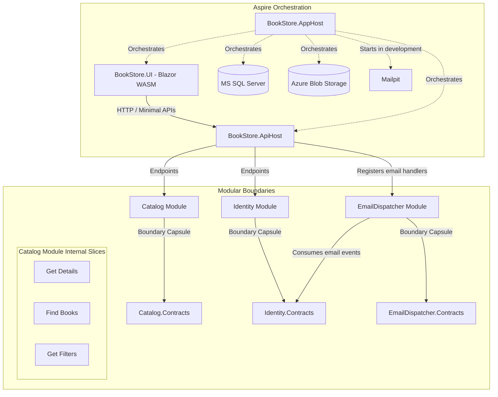

# 📚 BookStore

[](https://dotnet.microsoft.com/)
[](https://learn.microsoft.com/en-us/dotnet/csharp/)
[](https://learn.microsoft.com/en-us/dotnet/aspire/)
[](#-architecture)
[](LICENSE)

BookStore is a .NET 10 application built to showcase modern development practices, utilizing a Modular Monolith with Vertical Slice Architecture, Minimal APIs, and .NET Aspire for cloud-native orchestration. It is designed with a strong focus on boundary isolation, testability, and clean code to deliver a clean, robust, and well-tested codebase. This project is continuously evolving, with new modules and features being actively built.

## 🌟 Tech Stack

- **Backend:** .NET 10, ASP.NET Core Minimal APIs, Entity Framework Core 10
- **Frontend:** Blazor WebAssembly
- **Orchestration:** .NET Aspire, OpenTelemetry, Azure Blob Storage (Azurite)
- **Database:** MS SQL Server
- **Testing:** xUnit v3, FluentAssertions, NSubstitute, Testcontainers

## 🏗️ Architecture

The system uses a **Modular Monolith** approach, with **Vertical Slice Architecture** applied internally within modules.



### Key Principles

- **Isolated Boundaries:** Modules communicate strictly through `Contracts`. Implementation details remain `internal` within module assemblies to prevent tight coupling.
- **Vertical Slices:** Features (e.g., endpoints, handlers, validators) are grouped together by capability rather than horizontal layers.
- **Quality Assurance:** Covered by isolated unit tests and full integration tests using containerized databases to verify real-world behavior.

## 📂 Project Structure

```text
├── .aspire/                 # Aspire orchestration assets
├── src/
│   ├── Hosts/               # API, Blazor UI, Aspire AppHost
│   ├── Modules/             # Core modules (e.g., Catalog)
│   └── Shared/              # Shared configurations and utilities
└── tests/                   # Unit and integration tests
```

## 🚀 Getting Started

To run and use the multi-service application locally:

1. Install the [.NET 10 SDK](https://dotnet.microsoft.com/download/dotnet/10.0), [Docker Desktop](https://www.docker.com/products/docker-desktop/), and Aspire CLI **13.6.5** (the tested version, aligned with this AppHost's SDK; update it when the SDK is updated):
   ```bash
   dotnet tool install --global Aspire.Cli --version 13.6.5
   ```
2. Complete the [one-time local API setup](#one-time-local-api-setup) if this is a fresh development machine.
3. From the repository root, start the application:
   ```bash
   aspire run
   ```
4. Open the Aspire Dashboard URL shown in the console, then open the `bookstore-ui` endpoint to use the application.

### One-time local API setup

The API requires a Data Protection certificate and Identity authentication settings. Store them in the API project's User Secrets, never in source control. The API project already has a `UserSecretsId`; these settings are loaded when Aspire starts the API. The commands below use Bash, OpenSSL, Python 3, and the .NET CLI. On Windows, run them in WSL; native PowerShell is not supported by these commands.

For a fresh development machine, run the following one-time setup from the repository root in an interactive shell. Create a password-protected RSA certificate outside the repository. OpenSSL prompts for the private-key and PFX passwords:

```bash
umask 077
CERT_DIR="$HOME/.local/share/bookstore/data-protection"
mkdir -p "$CERT_DIR"
chmod 700 "$CERT_DIR"
KEY_RING="src/Hosts/BookStore.Api/.data-protection-keys"
if [ -n "$(find "$KEY_RING" -maxdepth 1 -name 'key-*.xml' -print -quit 2>/dev/null)" ]; then
  echo "An existing key ring was found; restore its matching certificate instead of creating a new one." >&2
  exit 1
fi
for file in "$CERT_DIR/development-key.pem" "$CERT_DIR/development-cert.pem" "$CERT_DIR/development.pfx"; do
  if [ -e "$file" ]; then
    echo "An existing certificate file was found; refusing to overwrite it." >&2
    exit 1
  fi
done
openssl req -x509 -newkey rsa:3072 \
  -keyout "$CERT_DIR/development-key.pem" \
  -out "$CERT_DIR/development-cert.pem" -days 365
openssl pkcs12 -export \
  -inkey "$CERT_DIR/development-key.pem" \
  -in "$CERT_DIR/development-cert.pem" \
  -out "$CERT_DIR/development.pfx"
rm "$CERT_DIR/development-key.pem" "$CERT_DIR/development-cert.pem"
```

Store the PFX path and password, plus a random signing key and the local Identity values, in the API's User Secrets. This one-time setup uses Python 3 to prompt for the PFX password without echoing or placing it in shell history or command arguments:

```bash
API_PROJECT="src/Hosts/BookStore.Api/BookStore.Api.csproj"
python3 - <<'PY' | dotnet user-secrets set --project "$API_PROJECT"
import base64
import getpass
import json
import os
import secrets

password = getpass.getpass("PFX password: ")
if not password:
    raise SystemExit("The PFX password must not be empty.")

print(json.dumps({
    "DataProtection:Certificate:Path": os.path.expanduser(
        "~/.local/share/bookstore/data-protection/development.pfx"
    ),
    "DataProtection:Certificate:Password": password,
    "Identity:Authentication:SigningKey": base64.b64encode(
        secrets.token_bytes(32)
    ).decode("ascii"),
    "Identity:Authentication:Issuer": "https://localhost:5001",
    "Identity:Authentication:Audience": "bookstore-ui-development",
    "Identity:Authentication:AllowedOrigins:0": "https://localhost:7128",
}))
PY
```

Skip this setup when these values are already configured; it generates a new signing key. The development certificate is valid for one year. Before it expires, rotate to a newly created certificate: first make the new certificate available as a previous certificate on every instance, and only then switch any instance to use it as current. Keep the old certificate and every other certificate needed by existing keys configured as previous certificates on every instance. Retain all required PFX certificates and passwords until no key or backup needs them. Expiry alone does not prevent decrypting old keys with their private certificate, but do not use an expired certificate to protect newly created keys.

Back up and restore the complete `.data-protection-keys` key ring with all required PFX certificates and their passwords, and restore the same `DataProtection:ApplicationName`. Without that backup, Data Protection-protected tokens and outbox payloads may become unreadable. If restoring pending outbox messages, restore their database as well. The key-ring directory is git-ignored; a clean, recloned checkout does not contain it.

### Registering and signing in

Open the UI endpoint from the Aspire Dashboard, register an account, and confirm the email using the link captured by Mailpit. Then sign in. Use **Forgot password** to request a reset email if needed. Confirmation and recovery emails are queued for delivery; a `204` response means the request was accepted, not that an email was delivered.

Registration retrieves the active password policy from the Identity API before submission and validates it locally alongside password confirmation. The Identity contracts provide shared FluentValidation rules for the UI and registration validator, while ASP.NET Identity remains authoritative and may apply additional requirements. The policy response is not cached; deployments must keep Identity password settings consistent across API instances. If the policy cannot be retrieved or understood, the UI logs a warning without displaying a policy error, checks the required fields and confirmation, and lets the API validate the password.

### Viewing development emails

During local development, the AppHost starts Mailpit and configures the API to send email to it. In the Aspire Dashboard, open the `mailpit` resource and follow its web endpoint to view captured messages. Mailpit is a development sink, not a production sender.

Production deployments require a shared, durable Data Protection key ring and consistent certificate and Identity settings across API instances. Use a secret manager and a shared rate limit at the gateway; do not use local development secrets or Mailpit in production.

## 🤝 Let's Connect

Feel free to reach out to discuss modern .NET architecture, software engineering, or potential opportunities.

- 💼 **LinkedIn:** [Peter Kovecses](https://www.linkedin.com/in/peterkovecses/)
- ⭐ **Give it a Star:** If you like what you see, please star this repository—it helps!
